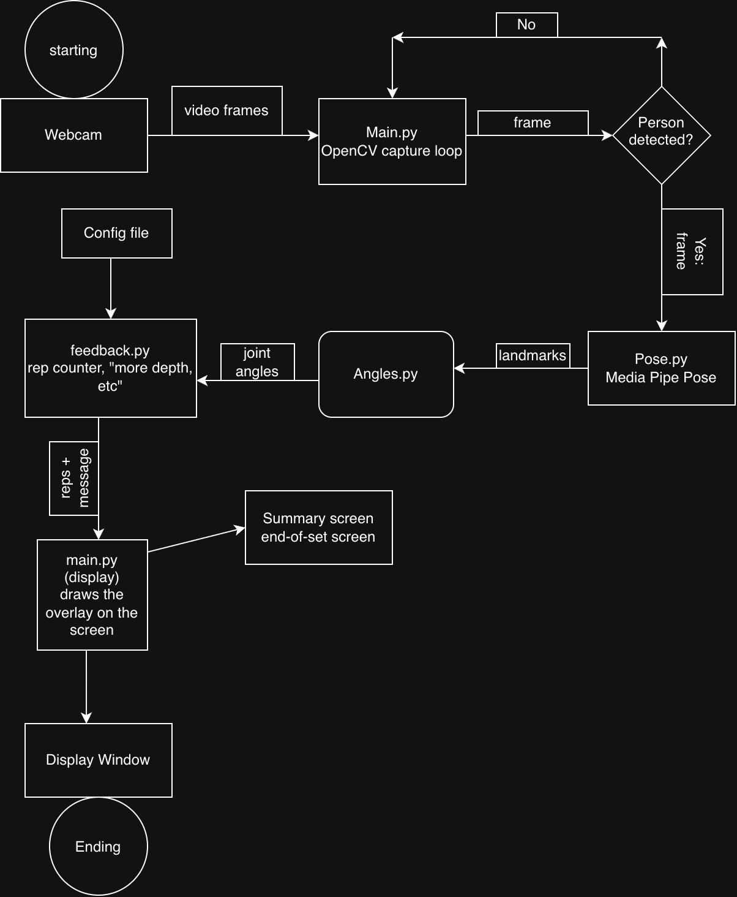

# Physio Form Corrector

A tool that uses your webcam to check your form during physiotherapy exercises and give feedback in real time.

## Project goal

Most people do their physio exercises alone at home with no one checking their form. This project uses a webcam and pose detection to track the body, count reps, and tell the user when their form is off.

## MVP scope

The first version covers one exercise, the squat, filmed from the side:

- Live webcam feed with a skeleton overlay
- Knee and back angle calculation
- Rep counting
- Simple feedback like "Go deeper" or "Keep your chest up"
- Summary of reps and form at the end of a set

## Future plans

- Have a physical therapist check the angle thresholds
- Add a second exercise (shoulder raise or lunge)
- Save session history and track progress
- Add audio cues

## Tech stack

Python, OpenCV, MediaPipe Pose, NumPy, pytest

## Diagrams

- System diagram: 
- [Eisenhower Matrix (PDF)](docs/eisenhower_matrix.pdf)
