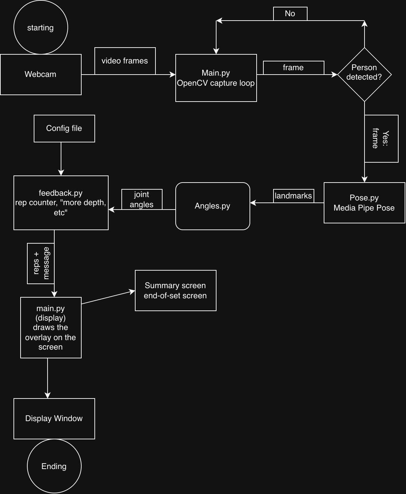

# Physio Form Corrector

A tool that uses your webcam to check your form during physiotherapy exercises and give feedback in real time.

## Project goal

Most people do their physio exercises alone at home with no one checking their form. This project uses a webcam and pose detection to track the body, count reps, and tell the user when their form is off.

## MVP scope

The first version covers one exercise, the push-up, filmed from the side:

- Live webcam feed with a skeleton overlay
- Elbow angle (depth) and body-line angle (hip sag) calculation
- Rep counting
- Simple feedback like "Go lower" or "Hips sagging – tighten your core"
- Summary of reps and form at the end of a set

## Future plans

- Have a physical therapist check the angle thresholds
- Add a second exercise (shoulder raise or lunge)
- Save session history and track progress
- Add audio cues

## Tech stack

Python, OpenCV, MediaPipe Pose, NumPy, pytest

## Setup

Requires Python 3.9+ (tested on macOS, Apple Silicon).

```bash
git clone https://github.com/JoelJacob1921/physio-form-corrector.git
cd physio-form-corrector
python3 -m venv .venv
source .venv/bin/activate
pip install --upgrade pip
pip install --no-compile -r requirements.txt
```
On Windows, use `python` instead of `python3` and activate with `.venv\Scripts\activate` instead of `source .venv/bin/activate`. The other commands are the same.

> `--no-compile` is needed because MediaPipe 1.2.3 ships with a typo in one of its own internal test files, which crashes pip's compile step. Skipping that step is safe; Python compiles the files it actually uses on first run.


## Usage
When the virtual environment is active, run from the repo root:

```bash
python src/main.py
```
A window opens with your live webcam feed. Click the window and press `q` to quit.
> On the first run, your computer may ask for camera permission. Click **Allow**, then run the command again. (macOS: System Settings → Privacy & Security → Camera. Windows: Settings → Privacy & security → Camera.)
> If you have an iPhone nearby, macOS may list it as a camera too. If the wrong camera opens, change `CAMERA_INDEX` at the top of `src/main.py`.


## Diagrams

- System diagram: 
- [Eisenhower Matrix (PDF)](docs/eisenhower_matrix.pdf)


## Changes from the original plan

- Switched the MVP exercise from squats to push-ups. The only thing that changes is the scope of the joints (elbow and shoulder-hip-ankle angles instead of knee and back angles).


